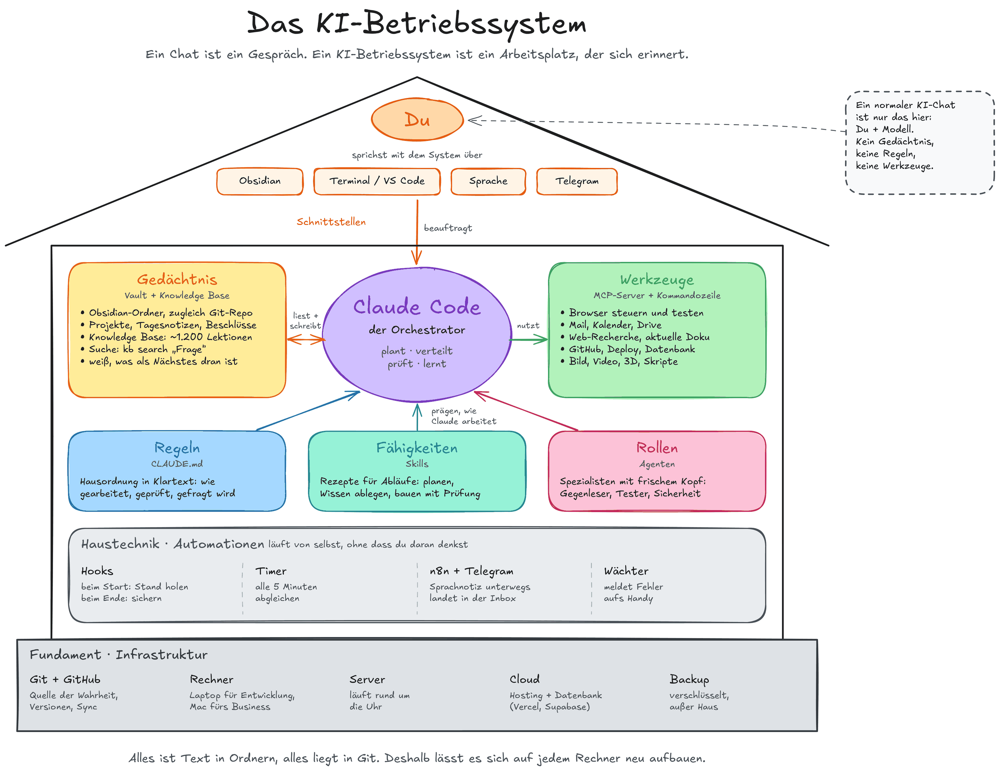

# AI OS Teil 1: Vom Chat zum KI-Betriebssystem

Die meisten nutzen KI wie eine Suchmaschine mit Antworten: Frage rein, Antwort raus, und morgen fängt alles wieder bei null an. Diese Anleitung zeigt, wie du dir mit Claude Code ein eigenes KI-Betriebssystem aufbaust: mit Gedächtnis, eigenen Regeln, angebundenen Werkzeugen, Rezepten, Prüfern und einer Wissensbasis, die mitlernt.

Du brauchst keine Erfahrung mit dem Terminal. Du brauchst einen Mac oder Windows-Rechner und ein Claude-Abo (mindestens Pro). Den Rest richtest du gemeinsam mit Claude ein.



## So fängst du an

**Weg 1: Lesen und mitmachen.** Fang bei [Bevor du anfängst](anleitung/00-bevor-du-anfaengst.md) an und arbeite die Teile der Reihe nach durch. Jeder Teil hat ein Video von 2 bis 3 Minuten und eine Seite mit allen Prompts und Befehlen zum Kopieren.

**Weg 2: Claude führt dich.** Installiere Claude Code wie in [Teil 1](anleitung/01-claude-code-installieren.md) beschrieben. Starte Claude dann im Terminal mit `claude` und schick diesen Satz:

```text
Hol dir die Anleitung von https://github.com/marcgarding54-create/AI-OS in den Ordner ~/ai-os-anleitung (mit git clone oder, falls git fehlt, als ZIP), lies dort BEGLEITMODUS.md und begleite mich Schritt für Schritt durch AI OS Teil 1.
```

Claude prüft, was bei dir schon da ist, richtet ein, was es selbst einrichten kann, und führt dich durch alles, was nur du tun kannst. Den Stand merkt es sich in einer Datei. Beim nächsten Mal reicht: „Mach weiter mit AI OS.“

Du nutzt Claude bisher nur im Chat auf claude.ai? Dann schick dort den Link zu [BEGLEITMODUS.md](BEGLEITMODUS.md) und bitte um Begleitung. Claude erklärt dir dann jeden Schritt, und du führst ihn selbst aus.

## Die 13 Teile

| Teil | Thema | Was danach steht |
|---|---|---|
| [1](anleitung/01-claude-code-installieren.md) | Claude Code installieren | Claude läuft und hat seine erste Datei angelegt |
| [2](anleitung/02-arbeitsplatz.md) | Der Arbeitsplatz | Obsidian als Vault, Claude darin über Claudian |
| [3](anleitung/03-hausordnung.md) | Die Hausordnung | Deine Regeln in der CLAUDE.md, global und je Projekt |
| [4](anleitung/04-kurzzeitgedaechtnis.md) | Das Kurzzeitgedächtnis | Brain Dump, Tagesnotiz, Übertrag, Start- und End-Routine |
| [5](anleitung/05-sichern.md) | Sichern | Privates GitHub-Repo, Schlüssel nur in `.env`, gitleaks als Wächter |
| [6](anleitung/06-werkzeuge-anbinden.md) | Werkzeuge anbinden | Dein Kalender als erstes Werkzeug |
| [7](anleitung/07-rezepte-und-rollen.md) | Rezepte und Rollen | Ein Skill für den Wochenbericht, ein Agent, der gegenliest |
| [8](anleitung/08-projekte-planen.md) | Projekte planen | Ein Vorhaben mit KICKOFF.md und ENTSCHEIDUNGEN.md |
| [9](anleitung/09-pruefen-statt-glauben.md) | Prüfen statt glauben | Nie „fertig“ ohne Beleg, `/goal` mit Prüfer |
| [10](anleitung/10-knowledge-base.md) | Die Knowledge Base | Fehler werden zu Lektionen, die Claude wiederfindet |
| [11](anleitung/11-automationen.md) | Automationen | Hook am Sitzungsende, Wochenbericht nach Zeitplan |
| [12](anleitung/12-mehrere-rechner.md) | Mehrere Rechner | Dein System auf einem zweiten Rechner, Übergabe-Notizen |
| [13](anleitung/13-was-du-damit-bauen-kannst.md) | Was du damit bauen kannst | Dein erstes eigenes Vorhaben |

Durch alle Teile läuft ein Beispiel: ein persönlicher Wochenbericht. Er wächst mit jedem Teil, vom ersten Stichpunkt bis zum Bericht, der freitags von allein entsteht.

## Material

- [Langfassung als PDF](material/langfassung.pdf): Teil 1 bis 12 auf Folien, mit Links und Stolpersteinen
- [Kurzfassung als PDF](material/kurzfassung.pdf): die Präsentation in 15 Folien, etwa 10 Minuten
- Grafiken: [Das KI-Betriebssystem](material/grafiken/1-das-ki-betriebssystem.png), [Der Arbeitsablauf](material/grafiken/2-der-arbeitsablauf.png), [Der Werkzeugkasten](material/grafiken/3-der-werkzeugkasten.png), [Akte und Handbuch](material/grafiken/4-akte-und-handbuch.png)

## Gut zu wissen

- Preise, Menünamen und Befehle sind auf dem Stand vom Oktober 2026. Was bei den Aufnahmen nicht geprüft werden konnte, ist auf den Seiten mit **ungeprüft** markiert.
- Die Sprecherstimme der Videos ist KI-generiert (ElevenLabs). Die Bildschirme sind echte Aufnahmen.
- Fehler gefunden oder hängen geblieben? Frag zuerst Claude. Wenn die Anleitung selbst falsch ist, melde es gern als Issue in diesem Repo.

Erstellt von Marc Garding, gemeinsam mit Claude.
